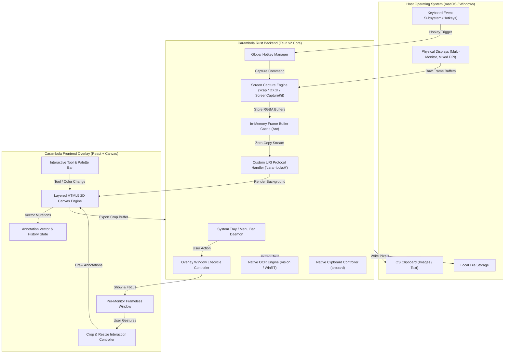
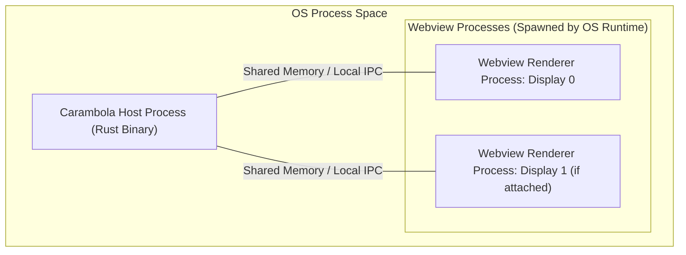
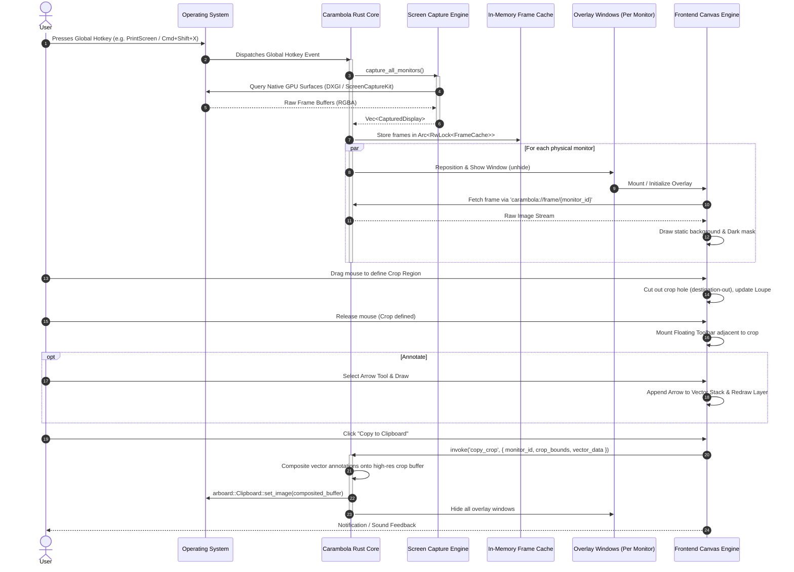
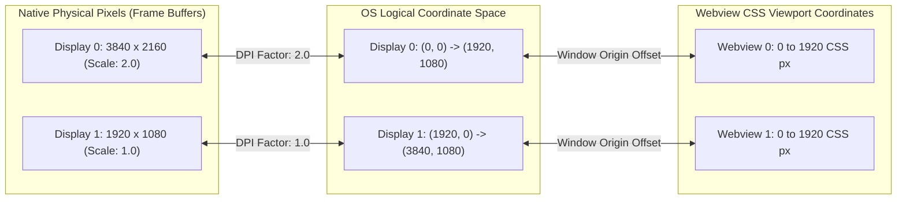

# Carambola — System Architecture & Design Specification

This document defines the production system architecture, process model, internal module hierarchy, data pipelines, and platform-specific engineering strategies for **Carambola**.

---

## 1. System Overview

Carambola is an open-source, lightweight, cross-platform screenshot and annotation application designed for macOS and Windows. It provides an instantaneous screen-capture workflow activated by a global hotkey or system tray icon, presenting a transparent, full-screen overlay for crop selection, non-destructive vector annotation, offline OCR text extraction, and rapid output (clipboard, local disk, or cloud upload).



---

## 2. Process Architecture

Carambola executes as a dual-tier hybrid application leveraging Tauri v2:

1. **Rust Core Process (Main / Host Process):**
   - Operates as a permanent background daemon without a taskbar or Dock icon.
   - Hosts the system tray icon, global keyboard event listeners, capture subsystems, and native OS interop.
   - Manages the lifecycle of webview windows, system permissions, and clipboard interactions.
   - Runs on the native OS message loop (Win32 message loop on Windows, `NSApplication` run loop on macOS).

2. **Webview Overlay Processes (Worker / UI Tier):**
   - For every active physical monitor, a frameless, transparent, borderless webview window is spawned.
   - On Windows: Hosted by `msedgewebview2.exe`.
   - On macOS: Hosted by `com.apple.WebKit.WebContent`.
   - Webviews render the UI using GPU-accelerated HTML5 Canvas, isolated from the host OS via Tauri's IPC bridge.



---

## 3. Rust Backend Module Architecture

The backend is structured into modular, strictly decoupled Rust crates/modules:

```
src-tauri/src/
├── main.rs                 # Application entry point, single-instance lock
├── app_state.rs            # Thread-safe global state container
├── capture/                # Screen capture abstraction and backends
│   ├── mod.rs              # ScreenCapturer trait definition
│   ├── engine.rs           # xcap integration & display enumeration
│   ├── frame.rs            # Raw RGBA frame buffer & metadata structs
│   └── platform/           # OS-specific fallbacks (DXGI / ScreenCaptureKit)
│       ├── macos.rs
│       └── windows.rs
├── window/                 # Overlay window lifecycle management
│   ├── mod.rs              # Window manager trait and controller
│   ├── pool.rs             # Pre-warmed window pool & visibility controls
│   └── coordinator.rs      # Multi-monitor positioning and sync
├── hotkey/                 # Global shortcut listener
│   ├── mod.rs              # Hotkey registration and re-binding
│   └── handler.rs          # Hotkey event dispatcher
├── tray/                   # System tray / Menu bar integration
│   ├── mod.rs              # Tray icon setup, menus, and events
│   └── menu.rs             # Context menu actions (Capture, Settings, Exit)
├── protocol/               # Custom URI protocol handler ('carambola://')
│   └── mod.rs              # In-memory image buffer streaming
├── ocr/                    # Offline native OCR extraction
│   ├── mod.rs              # OcrEngine trait
│   ├── macos.rs            # Apple Vision Framework bindings
│   └── windows.rs          # Windows.Media.Ocr WinRT bindings
├── clipboard/              # Clipboard operations
│   └── mod.rs              # arboard integration (image & text copy)
├── storage/                # File export and user settings persistence
│   ├── config.rs           # JSON-backed configuration
│   └── export.rs           # PNG/JPEG encoding and disk write
└── commands/               # Tauri IPC commands callable from frontend
    ├── capture.rs          # Query frame metadata, trigger re-capture
    ├── export.rs           # Copy to clipboard, save to file
    ├── ocr.rs              # Execute OCR on crop bounds
    └── window.rs           # Dismiss overlay, minimize, resize
```

---

## 4. Frontend Component Structure

The frontend is built with React and TypeScript, structured around a lightweight layered canvas pipeline:

```
src/
├── App.tsx                 # Root router & window coordinator
├── main.tsx                # React mount point
├── styles/
│   ├── globals.css         # Reset & transparency styling
│   └── animations.css      # Smooth UI transitions
├── components/
│   ├── overlay/
│   │   ├── OverlayContainer.tsx  # Fullscreen root container
│   │   ├── LayeredCanvas.tsx     # 4-layer compositing engine
│   │   ├── SelectionBox.tsx      # SVG/DOM crop border & resize handles
│   │   ├── LoupeMagnifier.tsx    # Sub-pixel precision zoom loupe
│   │   └── DimensionBadge.tsx    # W x H pixel counter tooltip
│   ├── toolbar/
│   │   ├── FloatingToolbar.tsx   # Tool palette anchored to selection
│   │   ├── ToolButton.tsx        # Icon button with tooltip & hotkey
│   │   ├── ColorPalette.tsx      # Color & stroke width selector
│   │   └── ActionButtons.tsx     # Copy, Save, OCR, Upload, Cancel
│   └── text-editor/
│       └── InPlaceTextEditor.tsx # ContentEditable / input box for text
├── hooks/
│   ├── useCanvasRenderer.ts# Main requestAnimationFrame render loop
│   ├── useCropGesture.ts   # Mouse drag, crop creation, and handle resizing
│   ├── useAnnotationState.ts# Vector element stack, undo, redo
│   ├── useDisplayInfo.ts   # Display resolution, DPI, and monitor index
│   └── useShortcuts.ts     # In-overlay keyboard shortcuts (Esc, Ctrl+Z)
├── lib/
│   ├── canvas/
│   │   ├── drawVectors.ts  # Pure vector rendering functions
│   │   ├── smoothStroke.ts # Catmull-Rom spline / Douglas-Peucker smoother
│   │   ├── pixelShaders.ts # CPU/OffscreenCanvas blur and mosaic filters
│   │   └── geometry.ts     # Hit-testing, bounding box calculations
│   └── ipc/
│       ├── commands.ts     # Strongly-typed Tauri command wrappers
│       └── protocol.ts     # 'carambola://' URL generator
└── types/
    ├── annotations.ts      # Vector element models & union types
    ├── crop.ts             # Rect, Point, HandlePosition definitions
    └── display.ts          # Monitor and coordinate models
```

---

## 5. End-to-End Screenshot Data Flow



---

## 6. Multi-Monitor Coordination Architecture

Handling multi-monitor environments requires strict coordination between physical pixel grids, logical OS coordinates, and per-monitor DPI scaling.

### Coordinate Space Translation



1. **Per-Display Isolation:**
   - Every monitor runs an independent Tauri window instance with label `overlay-{monitor_id}`.
   - The window is locked to the exact logical position `(x, y)` and size `(width, height)` of its target display via `window.set_position()` and `window.set_size()`.
2. **Cross-Display Dragging & Cursor Handoff:**
   - When the user drags a selection box past the edge of Monitor 0 towards Monitor 1:
     - Rust tracks the global mouse coordinate using OS-level polling or mouse move events forwarded from webviews.
     - When the selection crosses monitor boundaries, an IPC event `cross_monitor_drag` is broadcast to synchronize the selection rectangle across both windows.
   - For MVP, selection is contained within the active monitor where the mouse gesture began, which covers 98% of user capture workflows and eliminates complex cross-monitor canvas stitching. Cross-monitor spanning will be enabled in Phase 2.

---

## 7. Platform-Specific Engineering

### 7.1 macOS Implementation Strategy

#### Graphics & Capture Pipeline
- **API:** macOS 12.3+ introduced **ScreenCaptureKit (SCK)**, which replaces the deprecated `CGDisplayStream` and `CGWindowListCreateImage`.
- SCK provides zero-copy frame access via Metal textures, executing captures in **under 15 ms**.
- **Display Identification:** Map `CGDirectDisplayID` to Tauri monitor identifiers to guarantee correct overlay alignment.

#### Window Styling & Level (`NSPanel`)
- A standard `NSWindow` cannot overlay system UI elements (such as the macOS Menu Bar, Dock, or active Mission Control spaces).
- **Solution:** Access the native `NSWindow` handle via `window.ns_window()` and customize its properties:
  - Set window level to `NSScreenSaverWindowLevel` ($kCGScreenSaverWindowLevel = 1000$) or `NSStatusWindowLevel` so it floats above the Dock and Menu Bar.
  - Set collection behavior: `NSWindowCollectionBehaviorCanJoinAllSpaces | NSWindowCollectionBehaviorFullScreenAuxiliary`. This guarantees the overlay can appear over full-screen native apps without triggering a macOS space-transition animation.
  - Enable transparency: `window.set_transparent_titlebar(true)`, `[ns_window setOpaque:NO]`, `[ns_window setBackgroundColor:[NSColor clearColor]]`.

#### Permissions & Privacy
- **Screen Recording Permission:** macOS requires explicit user approval under *System Settings > Privacy & Security > Screen Recording*.
  - Verification API: Call `CGPreflightScreenCaptureAccess()` at startup.
  - Request API: If false, trigger `CGRequestScreenCaptureAccess()` and guide the user via a native dialog.
  - macOS 15 (Sequoia) introduces periodic permission re-prompts; the app must handle runtime permission revocation gracefully without crashing.
- **Accessibility Permission:** Not required for global hotkeys when using Carbon `RegisterEventHotKey` or `global-hotkey` crate; only needed if intercepting arbitrary keystrokes via `CGEventTap`.

#### Architectures & Packaging
- Dual universal binary targeting `x86_64` (Intel) and `aarch64` (Apple Silicon).
- Signed with Developer ID Application certificate and notarized via Apple Notary Service (`xcrun notarytool`) to prevent Gatekeeper warnings.

---

### 7.2 Windows Implementation Strategy

#### Graphics & Capture Pipeline
- **Primary:** **DXGI Desktop Duplication API** (`IDXGIOutputDuplication`).
  - Accesses the desktop surface directly from the GPU swap chain.
  - Capture latency: **5–12 ms**.
- **Fallback 1:** **Windows Graphics Capture (WGC)** (`Windows.Graphics.Capture`).
  - Supported on Windows 10 (1903+) and Windows 11.
  - Gracefully captures screens without causing yellow capture borders if `IsBorderRequired = false` (Windows 11).
- **Fallback 2:** **GDI (`BitBlt`)**.
  - Fallback for headless environments or virtual machines where hardware DirectX acceleration is unavailable.

#### Window Styling & Win32 Extended Styles
- To prevent visual artifacts, flicker, and black background flashes:
  - Set extended window styles via `SetWindowLongPtrW`:
    - `WS_EX_TOPMOST`: Keep overlay on top of all windows.
    - `WS_EX_TOOLWINDOW`: Hide from Alt-Tab task switcher.
    - `WS_EX_NOREDIRECTIONBITMAP`: Enable hardware-accelerated direct DWM composition.
  - Configure `tauri.conf.json` with `transparent: true` and `decorations: false`.

#### High-DPI Awareness
- Manifest must specify **Per-Monitor V2 DPI Awareness** (`PerMonitorV2` in application manifest).
- When a window moves between a 150% scaled laptop screen and a 100% external monitor, handle `WM_DPICHANGED` messages to recalculate canvas buffer sizes and avoid blurry or distorted overlays.

#### Architectures & Packaging
- Native compilation for `x86_64` and `aarch64` (Windows on ARM).
- Packaged as MSIX or NSIS installer.
- Microsoft Authenticode code signing with an EV or standard code-signing certificate to prevent Windows Defender SmartScreen blocks.

---

## 8. Latency & Performance Budget

To guarantee a responsive, native desktop feel, the capture-to-display pipeline is subjected to a strict time budget:

| Stage | Operation | Budget | Measurement Method |
| :--- | :--- | :--- | :--- |
| **Stage 1** | Hotkey Press $\rightarrow$ Rust Event Handler | $\le 2\text{ ms}$ | High-resolution timestamp (`Instant::now()`) |
| **Stage 2** | Screen Capture Execution (All Monitors) | $\le 18\text{ ms}$ | DXGI / ScreenCaptureKit timer |
| **Stage 3** | Frame Cache Update & Protocol Ready | $\le 3\text{ ms}$ | Rust memory copy to cache |
| **Stage 4** | Window Reposition, Unhide & Focus | $\le 12\text{ ms}$ | OS Window Show message |
| **Stage 5** | Webview Canvas Frame Draw & Paint | $\le 10\text{ ms}$ | `performance.now()` in `requestAnimationFrame` |
| **Total** | **Hotkey to Interactive Selection Overlay** | **$\le 45\text{ ms}$** | **Total latency under 50 ms target** |

---

## 9. Memory Management Strategy

Carambola handles large amounts of raw pixel data (e.g. 66 MB for dual 4K monitors). To maintain stability and prevent memory leaks:

1. **In-Memory Frame Recycling:**
   - Frame buffers are not reallocated on every capture. The backend uses a pre-allocated buffer pool (`Vec<u8>`) resized only when display resolutions change.
2. **Webview Canvas Buffer Disposal:**
   - When the overlay is dismissed, the canvas context is cleared (`ctx.clearRect()`), and the background `ImageBitmap` is explicitly closed (`imageBitmap.close()`) to immediately release GPU textures.
3. **OS-Level Working Set Trimming:**
   - On Windows: After the overlay hides, call `SetProcessWorkingSetSize(GetCurrentProcess(), -1, -1)` to instruct the Windows Memory Manager to trim unused physical pages from the WebView2 process.
   - On macOS: Rely on automatic WebKit memory purge signals when windows are unmapped from the window server.

---

## 10. Security, Permissions, and Sandboxing

1. **Tauri IPC Isolation:**
   - Webviews run with minimal permissions. No filesystem access is permitted directly from JavaScript. All writes (saving screenshots) and reads are strictly mediated by Rust commands with explicit path validation.
2. **Local Processing Guarantee:**
   - All OCR, image manipulation, and annotations occur 100% locally on the user's CPU/GPU.
   - No screen content is transmitted over the network unless the user explicitly invokes an optional cloud upload action.
3. **Cloud Upload Security (Phase 3):**
   - Cloud upload credentials and tokens are stored in the OS secure storage (Keychain on macOS, Windows Credential Manager on Windows) via the `keyring` crate.

