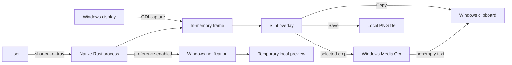

# Carambola architecture

Carambola's only supported desktop application is the native Rust and Slint
Windows x64 app in `native-app/`. It runs as a single per-user process with a
notification-area icon and a hidden Slint overlay that is shown for capture.
There is no webview, JavaScript bridge, installer, or updater in this app.

## Runtime

- `src/main.rs` owns startup, the Slint event loop, capture/session state,
  overlay callbacks, settings, OCR, and export coordination.
- `src/core/` contains platform-independent image frames, geometry,
  annotations, rendering, export, OCR result handling, settings, and workflow
  state.
- `src/platform/windows.rs`, `tray.rs`, and `windows_notifications.rs` provide
  Windows display, clipboard, dialog, hotkey, tray, OCR, and toast adapters.
- `ui/overlay.slint` defines the capture and annotation UI.
- Slint's Winit backend supplies window and event-loop integration. Carambola
  disables Winit file-drop targets because the application has no file-drop
  workflow.
- `vendor/winit-0.30.13/` is the patched Winit source used by the Cargo graph.

## Data handling

Capture and recognition are local application workflows. Image pixels and
annotations stay in memory until the user copies or saves them. Windows OCR
runs on a worker thread. Nonempty recognized text is copied to the system
clipboard; empty results and failures do not replace clipboard data. Every OCR
outcome closes the overlay, then reports its result through a native
notification when enabled. Notifications may use a temporary local crop
preview.

Settings use `%APPDATA%\Carambola\settings.json` with a per-user Roaming-folder
fallback. PNG exports go to the configured folder or a path chosen in Save As.
Optional window diagnostics are off by default and can contain window titles,
process paths, bounds, or native handles when explicitly enabled.

The marketing website in `website/` is a separate static React/Vite project. It
does not ship or implement the desktop application.

## Support boundary

Windows 10/11 x64 is the supported release target. Some macOS and Linux
adapters remain in the source, but those targets do not have a complete,
verified capture and packaging path. They are not advertised as supported.
