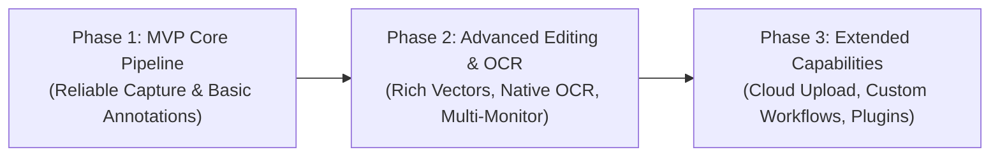

# Carambola — Implementation Plan & Milestone Roadmap

This document defines the prioritized development roadmap, phase-by-phase task breakdown, technical risk mitigations, acceptance criteria, and testing strategies for **Carambola**.

---

## 1. Development Phases Overview

Development is partitioned into three sequential phases to ensure a focused, iterative delivery:

---

## 2. Phase 1 — MVP (Minimum Viable Product)

### Objective
Deliver a production-stable, lightning-fast desktop screenshot tool that runs unobtrusively in the background, captures screens on a global hotkey, enables region cropping and basic drawing, copies to the clipboard, and saves to local disk.

### Features
1. **Background Daemon & System Tray:**
   - Background execution without a persistent taskbar or Dock presence.
   - System tray icon with context menu: *Capture (Shortcut)*, *Preferences*, and *Quit*.
2. **Global Hotkey Activation:**
   - Registration of global hotkeys (`PrintScreen` on Windows, `Cmd + Shift + X` on macOS).
   - Graceful conflict detection and logging.
3. **Hardware Screen Capture:**
   - Fast full-screen capture of the active display using `xcap` (DXGI on Windows, ScreenCaptureKit on macOS).
   - In-memory raw RGBA frame storage in Rust backend.
4. **Transparent Full-Screen Overlay:**
   - Pre-warmed, frameless, borderless, always-on-top window.
   - Instant unhide and focus on hotkey press (<50 ms target).
   - Semi-transparent backdrop with clear view of the captured screen.
5. **Interactive Crop Selection:**
   - Click-and-drag rectangular crop with 8-point resize handles.
   - Live pixel dimension badge ($W \times H$).
   - Magnifier loupe showing 4x zoomed pixels and RGB hex color at the cursor.
6. **Basic Vector Annotation Tools:**
   - **Arrow:** Straight line with directional arrowhead.
   - **Rectangle:** Hollow and filled bounding boxes.
   - **Pen / Freehand:** Smooth drawing with Catmull-Rom spline interpolation.
   - Basic color palette (Red, Green, Blue, Yellow, White, Black).
7. **Output Actions & Dismissal:**
   - **Copy to Clipboard:** Composites crop + annotations in Rust and writes to the system clipboard via `arboard`.
   - **Save to Disk:** Saves high-resolution PNG to the user's Pictures directory.
   - **Cancel / Dismiss:** Pressing `Esc` or clicking outside the selection instantly dismisses the overlay and returns to the background state.

### Dependencies
- **Rust Backend:** `tauri` v2, `tauri-plugin-global-shortcut`, `xcap`, `arboard`, `image`, `serde`, `parking_lot`.
- **Frontend:** `react`, `react-dom`, `lucide-react`, `tailwindcss`, `vite`.

### Technical Challenges & Mitigations
- **Challenge:** Webview white/black flash during window unhide.
  - *Mitigation:* Ensure `background: transparent !important` on `html`, `body`, and `#root`. Keep the canvas primed with the captured image before calling `window.show()`.
- **Challenge:** Latency over Tauri IPC.
  - *Mitigation:* Use custom URI protocol (`carambola://frame/0`) to stream in-memory frame bytes directly to native webview image decoder; avoid Base64.
- **Challenge:** macOS Screen Recording permission prompt.
  - *Mitigation:* Check permission at startup using `CGPreflightScreenCaptureAccess()` and present a clear modal instructing the user to grant permission if missing.

### Acceptance Criteria (Definition of Done)
- [ ] Application starts cleanly in the system tray with no visible dock/taskbar window.
- [ ] Pressing the global hotkey displays the screenshot overlay in $<50\text{ ms}$ on a pre-warmed instance.
- [ ] Dragging the mouse creates a crisp, non-distorted crop boundary.
- [ ] Arrows, boxes, and freehand lines render smoothly over the screenshot.
- [ ] Clicking "Copy" places a high-resolution, uncompressed PNG into the OS clipboard and hides the overlay.
- [ ] Clicking "Save" saves the image locally with timestamped filename (e.g. `Carambola_2026-10-30_170000.png`).
- [ ] Pressing `Esc` dismisses the overlay in $<10\text{ ms}$ without crashing or leaking memory.

### Required Tests
- **Unit Tests:** Crop geometry clamping, point-in-rect hit testing, arrow head angle math, frame buffer byte size calculations.
- **Integration Tests:** Hotkey registration/unregistration cycle, frame buffer capture integrity, clipboard image copy verification.

---

## 3. Phase 2 — Advanced Editing, OCR & Multi-Monitor

### Objective
Elevate Carambola to an indispensable daily driver by adding rich typography, privacy redaction tools (blur/mosaic), non-destructive history, platform-native offline OCR, and seamless multi-monitor management.

### Features
1. **Text Annotations:**
   - In-place text box editing with system IME support, font sizing, and automatic background contrast padding.
2. **Blur and Mosaic Tools:**
   - Redaction tools for hiding sensitive information (passwords, API keys, personal data).
   - Pixelated mosaic effect and Gaussian blur filter applied non-destructively to the vector tree.
3. **Full Undo / Redo Engine:**
   - Command pattern history stack supporting unlimited `Ctrl+Z` / `Ctrl+Y` (or `Cmd+Z` / `Cmd+Shift+Z`).
4. **Offline Native OCR (Optical Character Recognition):**
   - One-click "Copy Text from Crop" button on the floating toolbar.
   - macOS: Apple Vision Framework (`VNRecognizeTextRequest`).
   - Windows: Windows Media OCR (`Windows.Media.Ocr`).
   - 100% offline, privacy-safe, $<70\text{ ms}$ execution, with auto-copied text and notification feedback.
5. **Full Multi-Monitor Architecture:**
   - Independent per-monitor overlay windows for all connected screens.
   - Seamless cross-monitor selection dragging.
   - Per-monitor DPI scaling alignment (Retina + 1080p setups).
6. **Preferences & Settings Window:**
   - Dedicated Settings UI to configure hotkeys, default save folder, image format (PNG vs. JPEG), launch at startup, and Performance Mode (Turbo vs. Eco).

### Dependencies
- **Rust Backend:** `windows` (features `Media_Ocr`, `Graphics_Imaging`), `objc2-vision`, `objc2-foundation`.
- **Frontend:** Canvas pixel manipulation utilities.

### Technical Challenges & Mitigations
- **Challenge:** Performance of real-time blur/mosaic during mouse drag.
  - *Mitigation:* Apply pixel downsampling during active dragging (mosaic block size 10px), compute blur on an `OffscreenCanvas`, and cache the redacted region bitmap.
- **Challenge:** Windows 11 `PrintScreen` key override conflict.
  - *Mitigation:* Detect collision with Windows Snipping Tool and prompt the user with a 1-click shortcut re-mapper in Settings.

### Acceptance Criteria (Definition of Done)
- [ ] User can click anywhere in the selection to type multi-line text with full IME support.
- [ ] Mosaic and blur tools completely obscure underlying screen text with zero visual leakage.
- [ ] Undo and redo reliably revert and reapply all vector actions.
- [ ] Clicking "Extract Text" copies the exact text within the crop box to the clipboard in $<100\text{ ms}$.
- [ ] Works identically across multi-monitor setups with mixed DPI scaling (e.g. 200% Retina + 100% 1440p).
- [ ] User can customize hotkeys and save directories via the Settings UI.

---

## 4. Phase 3 — Extended Capabilities & Cloud Integration

### Objective
Empower advanced workflows with secure cloud sharing, extended export formats, and developer automation.

### Features
1. **Cloud Uploading & Shareable Links:**
   - Direct image upload to supported targets: Imgur (anonymous/authenticated), AWS S3 / Cloudflare R2, or custom Webhook/REST endpoint.
   - Automatic short link copying to clipboard with desktop toast notification.
   - API keys and tokens securely encrypted in native OS Keychain / Credential Manager (`keyring` crate).
2. **Extended Export Formats:**
   - WebP (lossless & lossy) for minimal file sizes.
   - PDF export with selectable embedded text (combining the image and OCR layers).
   - "Copy as Base64 Data URL" for direct pasting into web markdown editors.
3. **Advanced Annotation Capabilities:**
   - Step counter badges (auto-incrementing numbered circles: ①, ②, ③).
   - Highlighter marker with translucent blend mode (`multiply`).
   - Drop shadow styling on arrows and rectangles for readability on cluttered backgrounds.
4. **CLI & Automation Hooks:**
   - Headless CLI interface (`carambola --capture --fullscreen --output screenshot.png`).
   - Global webhook / script trigger executed after every successful screenshot.

---

## 5. Detailed Milestone Breakdown & Task List

### Milestone 1: Project Scaffolding & Core Architecture Verification
- [ ] **M1.1:** Initialize Tauri v2 repository with React, TypeScript, Vite, and Tailwind CSS.
- [ ] **M1.2:** Configure `tauri.conf.json` with multi-window templates, transparent window flags, and custom URI protocols.
- [ ] **M1.3:** Implement logging infrastructure (`env_logger` / `log`) and single-instance process lock.
- [ ] **M1.4:** Build prototype verifying that transparent, frameless windows unhide without white flashes on macOS and Windows.

### Milestone 2: Background Daemon, System Tray & Hotkey Listener
- [ ] **M2.1:** Implement system tray icon with native menu (*Capture*, *Quit*).
- [ ] **M2.2:** Integrate `tauri-plugin-global-shortcut` and configure default platform shortcuts.
- [ ] **M2.3:** Add hotkey conflict detection and graceful fallback handling.
- [ ] **M2.4:** Implement macOS screen recording permission check (`CGPreflightScreenCaptureAccess`).

### Milestone 3: Hardware Capture Engine & Frame Streaming
- [ ] **M3.1:** Implement `ScreenCapturer` trait wrapping `xcap`.
- [ ] **M3.2:** Benchmark screen capture execution time on multi-monitor setups ($<20\text{ ms}$).
- [ ] **M3.3:** Build thread-safe `Arc<RwLock<FrameCache>>` storing raw RGBA frames.
- [ ] **M3.4:** Implement `carambola://frame/{id}` custom protocol handler for zero-copy webview streaming.

### Milestone 4: Frontend Layered Canvas & Crop Interaction
- [ ] **M4.1:** Build `LayeredCanvas` component with static background, dark backdrop mask, and crop cutout.
- [ ] **M4.2:** Implement mouse gesture controller for drawing rectangular crop selections.
- [ ] **M4.3:** Build 8-point resize handles with cursor styling (`nwse-resize`, `nesw-resize`, etc.).
- [ ] **M4.4:** Implement sub-pixel magnifier loupe with RGB hex display and dimension tooltip.

### Milestone 5: Basic Vector Annotations & Floating Toolbar
- [ ] **M5.1:** Implement vector renderer for straight arrows, rectangles, and freehand pen strokes.
- [ ] **M5.2:** Implement Catmull-Rom spline smoothing algorithm for freehand pen lines.
- [ ] **M5.3:** Build floating toolbar anchored to the crop box with responsive boundary repositioning.
- [ ] **M5.4:** Implement color picker and stroke width selector.

### Milestone 6: Output Pipelines (Clipboard, Local Save, Dismissal)
- [ ] **M6.1:** Build Rust command to composite vector annotations onto the high-resolution crop buffer.
- [ ] **M6.2:** Integrate `arboard` for zero-latency clipboard bitmap pasting.
- [ ] **M6.3:** Implement PNG/JPEG local file export with user-configured naming patterns.
- [ ] **M6.4:** Implement instant window dismissal and memory cleanup on `Esc` or save completion.

### Milestone 7: Advanced Annotations, Undo/Redo & Native OCR (Phase 2)
- [ ] **M7.1:** Implement in-place text annotation tool with full IME support.
- [ ] **M7.2:** Implement blur and mosaic pixel shaders.
- [ ] **M7.3:** Implement immutable history stack (`undo` / `redo`).
- [ ] **M7.4:** Implement Apple Vision OCR on macOS (`VNRecognizeTextRequest`).
- [ ] **M7.5:** Implement Windows Media OCR on Windows (`Windows.Media.Ocr`).

---

## 6. Technical Risk Matrix & Mitigation Strategies

| Risk | Probability | Impact | Mitigation Strategy |
| :--- | :--- | :--- | :--- |
| **Windows 11 Snipping Tool Hotkey Conflict** | High | Medium | Detect registration failure; alert user; offer 1-click fallback shortcut (`Alt+A`) and instructions to disable Windows setting. |
| **macOS Screen Recording Permission Revocation** | Medium | High | Use `CGPreflightScreenCaptureAccess()` prior to capture; display friendly prompt pointing directly to System Settings. |
| **High Idle Memory in Long-Running Background** | Medium | Medium | Implement Adaptive Idle Purge: destroy webview after 30 min of inactivity; re-create on hotkey. |
| **Multi-Monitor Mixed DPI Blur** | Medium | High | Enforce Per-Display Overlays; render canvas at exact physical pixel dimensions (`width * devicePixelRatio`). |
| **DXGI Desktop Duplication Failure on Switchable GPUs** | Low | High | Implement automatic fallback to Windows Graphics Capture (WGC) and GDI `BitBlt`. |

